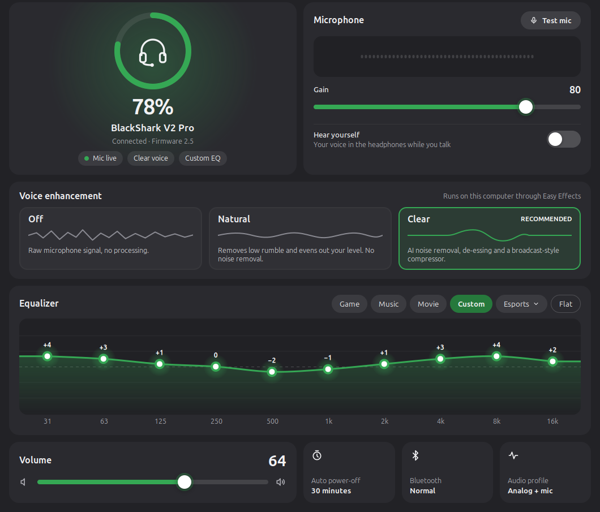
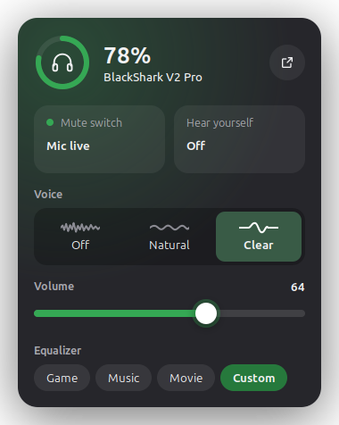
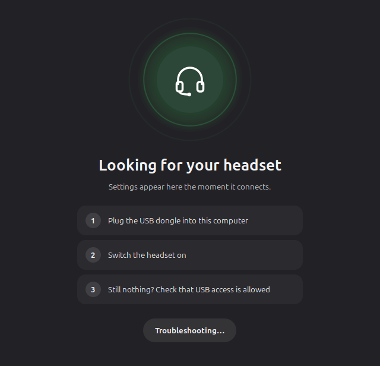

# BlackShark Control

A Linux app for the **Razer BlackShark V2 Pro** wireless headset. Razer Synapse only ships for Windows and macOS; this gives you the headset's settings, and a much better microphone, on Linux.



| Tray quick panel | When the headset is off or unplugged |
|---|---|
|  |  |

## Features

**Stored on the headset** (talks to it directly over USB, no kernel driver):

- Battery level and charging state, with a low-battery notification
- EQ presets: Game, Music, Movie, Custom and the five Esports profiles
- A 10-band custom EQ you drag directly (or scroll / arrow keys)
- Mic monitoring ("hear yourself", levels 1–10)
- Auto power-off timer and Bluetooth do-not-disturb
- Mic mute switch state, and presets changed with the headset's own EQ button

**On your computer** (PipeWire + [EasyEffects](https://github.com/wwmm/easyeffects)):

- **Voice enhancement**, the Linux stand-in for Synapse's mic enhancement:
  - **Clear**: AI noise removal (RNNoise) for keyboard, fan and room noise, plus a de-esser, compressor and limiter
  - **Natural**: rumble filter and gentle levelling, no noise removal
  - **Off**: the raw mic
- A **Test mic** button with a live waveform of what apps actually hear
- Mic gain, volume, and the audio profile (analog / digital)
- A tray icon with the battery level; click it for the quick panel

There's also a command-line tool:

```sh
blackshark-ctl status
blackshark-ctl preset music          # game | music | movie | custom | esports1..5
blackshark-ctl eq 3 2 0 0 -1 0 1 2 3 3
blackshark-ctl sidetone 5            # 0 = off
blackshark-ctl autooff 30            # 0 = never, 15-60
blackshark-ctl mic clear             # clear | natural | off
```

## Supported hardware

- **Razer BlackShark V2 Pro** (2023 model) through its **2.4 GHz USB dongle** (USB ID `1532:0555`).

Check yours with `lsusb | grep 1532`. Other BlackShark models use different protocols and aren't supported yet.

## Requirements

- Python 3 with PyGObject (GTK 3), which most desktops ship by default
- PipeWire with `pactl` and `parec` (`pulseaudio-utils` on Fedora)
- [EasyEffects](https://github.com/wwmm/easyeffects) 7.x, the native (non-Flatpak) build, for voice enhancement
- The Calf LV2 plugins (`calf-plugins`). The installer adds these on Debian, Ubuntu and Mint.
- A tray icon needs Cinnamon (XApp), or a desktop with AppIndicator support. Without one, the app opens as a normal window.

Tested on Linux Mint 22.3 (Cinnamon), PipeWire 1.0.5, EasyEffects 7.1.6, headset firmware 2.5.

## Install

```sh
git clone https://github.com/AbdullahSAhmad/blackshark-control.git
cd blackshark-control
./install.sh
```

Run it as your normal user. It asks for sudo only to:

- add a udev rule that gives your login session access to the headset (`data/70-razer-blackshark.rules`)
- install `calf-plugins` if it's missing

Everything else goes into your home folder.

Then open **BlackShark Control** from the menu. It also starts in the tray at login.

With voice enhancement on, apps record from **Easy Effects Source**, which the app sets as your default input. In Discord, Zoom or OBS, pick "Default" or "Easy Effects Source", and turn off the app's own noise suppression so the two don't stack.

## Uninstall

```sh
./uninstall.sh
```

## Good to know

- **Game, Music and Movie** are built into the headset's firmware and can't be read back, so the app shows them as built-in curves rather than sliders. **Custom** and the **Esports** profiles show their real curves.
- **The volume wheel on the headset** changes volume inside the headset, and over the dongle it doesn't report its position to the computer, so the on-screen volume can't follow it.
- **Volume is scaled in software** for this headset, the same in analog and digital mode, via a WirePlumber rule in `~/.config/wireplumber/`.
- **THX Spatial Audio** is proprietary Windows software and isn't available.

## How it works

The dongle exposes a vendor HID interface (report ID 2, 64-byte frames). The app sends the same commands Synapse does, through `/dev/hidraw`, from user space.

The protocol (framing, command IDs and the EQ apply sequences) was reverse-engineered by the [OpenRazer](https://github.com/openrazer/openrazer) community; see [openrazer PR #2862](https://github.com/openrazer/openrazer/pull/2862). All credit for it goes to them; this project is a user-space client of that work.

| File | What it does |
|---|---|
| `blackshark/protocol.py` | Headset protocol over hidraw |
| `blackshark/audio.py` | PipeWire and EasyEffects: profiles, volumes, mic presets |
| `blackshark/gui.py` | GTK 3 window, tray quick panel, background worker |
| `blackshark/widgets.py` | Cairo-drawn battery ring, EQ curve, waveform |
| `blackshark/cli.py` | `blackshark-ctl` |

## Disclaimer

Not affiliated with or endorsed by Razer. Razer and BlackShark are trademarks of Razer Inc. The protocol is reverse-engineered: it works on the hardware and firmware above, but use it at your own risk.

## License

GPL-2.0-or-later (see [LICENSE](LICENSE)), matching the OpenRazer driver the protocol comes from.
